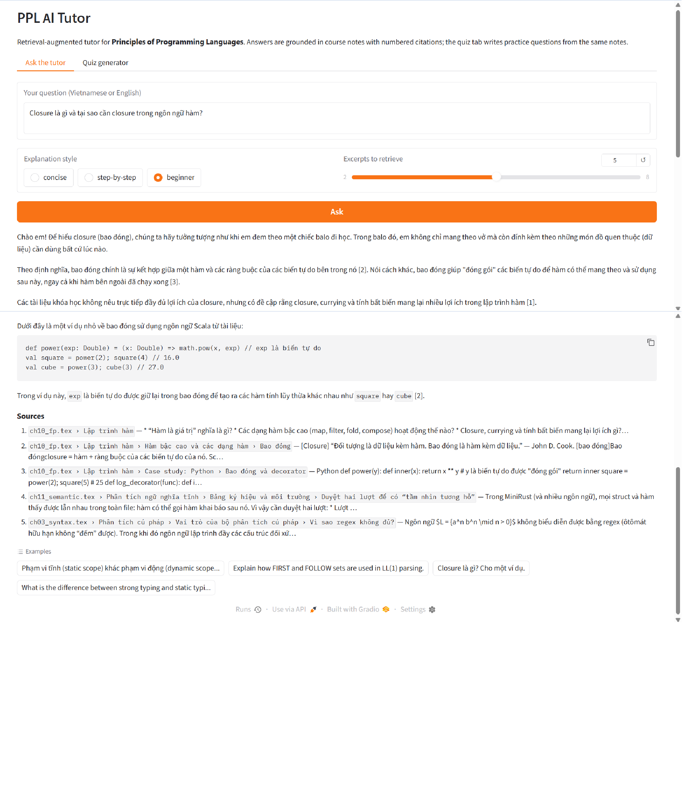
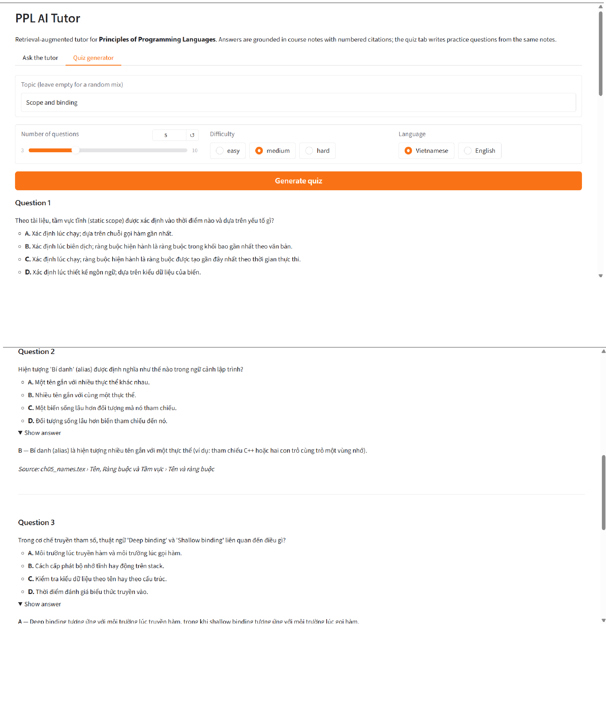

# PPL AI Tutor

[](https://github.com/CoDa-git19/ppl-ai-tutor/actions/workflows/ci.yml)


A retrieval-augmented **AI tutor** for the university course *Principles of Programming Languages* (PPL).
It answers student questions in Vietnamese or English **using only the course notes, with numbered citations**,
and generates practice multiple-choice quizzes from the same material.





**Run it locally:** see [Quickstart](#quickstart) (needs a free Gemini API key).

## Features

- **Grounded Q&A** — every answer cites the note excerpts it uses; out-of-scope questions are declined instead of invented.
- **Hybrid retrieval** — BM25 (lexical) and multilingual dense embeddings fused with Reciprocal Rank Fusion.
- **Quiz generator** — exam-style MCQs in JSON, validated before display (4 options, one correct answer, source link).
- **Explanation styles** — concise, step-by-step, or beginner-friendly.
- **Works on real course material** — ingests LaTeX (keeps code listings, drops comments), PDF, Markdown and text.
- **Measured** — a synthetic benchmark compares retrieval strategies (Hit@k, MRR).

## Architecture

```
 course notes (.tex .pdf .md)
          |
  loaders: LaTeX -> text (code blocks protected), section titles kept
          |
  chunking: ~900 chars, 150 overlap, paragraph-aware
          |
  index: multilingual-e5-small embeddings + BM25        (offline, once)
 ----------------------------------------------------------------------
  question --> BM25 top-20 ---\
           --> dense top-20 ---+--> RRF fusion --> top-k excerpts
                                                       |
                         prompt: rules + numbered excerpts + question
                                                       |
                         LLM (any OpenAI-compatible API, default Gemini)
                                                       |
                         answer with [n] citations  /  quiz JSON -> validation
```

## Results

Retrieval benchmark on 20 synthetic questions over 269 chunks of course notes
(each question was written by the LLM from one chunk; a hit means that chunk is retrieved):

| Retriever | Hit@1 | Hit@3 | Hit@5 | MRR |
|---|---|---|---|---|
| BM25 (lexical) | 0.50 | 0.70 | 0.80 | 0.644 |
| **Dense (multilingual-e5)** | **0.65** | **0.85** | **0.95** | **0.763** |
| Hybrid (RRF) | 0.60 | 0.85 | 0.95 | 0.749 |

Dense retrieval scored best. The LLM-written questions paraphrase the notes and mix Vietnamese with English terms,
which likely weakens exact-term matching (BM25); fusing in the weaker BM25 ranking cost a little at Hit@1, while hybrid
matched dense at Hit@3 and Hit@5.

Grounding check: 5 of 5 out-of-scope questions were correctly declined.

## Quickstart

```bash
python -m venv .venv
source .venv/bin/activate            # Windows PowerShell: .\.venv\Scripts\Activate.ps1
pip install -r requirements.txt
cp .env.example .env                 # Windows: Copy-Item .env.example .env   then paste your API key

python -m scripts.build_index        # reads data/raw (falls back to data/sample)
python -m scripts.check_llm          # verifies the API key and model
python -m scripts.ask "What is the difference between static and dynamic scope?"
python app.py                        # web UI at http://127.0.0.1:7860
```

Evaluation:

```bash
python -m scripts.make_eval --n 20   # synthetic questions -> eval/qa.jsonl
python -m scripts.eval_retrieval     # BM25 vs dense vs hybrid -> docs/retrieval_results.md
pytest -q                            # unit tests (no network, no API key)
```

## Configuration

All settings are environment variables (or `.env`):

| Variable | Default | Notes |
|---|---|---|
| `LLM_API_KEY` | — | required |
| `LLM_BASE_URL` | Gemini OpenAI-compatible endpoint | any OpenAI-compatible API works (Groq, OpenAI, local servers) |
| `LLM_MODEL` | `gemini-3.8-flash` | run `python -m scripts.check_llm` to list available models |
| `EMBED_MODEL` | `intfloat/multilingual-e5-small` | multilingual, supports Vietnamese |
| `CHUNK_SIZE` / `CHUNK_OVERLAP` | 900 / 150 | characters |

## Project structure

```
ppl_tutor/
  loaders.py     LaTeX / PDF / Markdown / text -> titled sections
  chunking.py    paragraph-aware overlapping chunks
  index.py       embeddings, save/load index
  retrieval.py   BM25, dense, hybrid (RRF)
  llm.py         OpenAI-compatible client, retries, JSON extraction
  prompts.py     tutor, quiz and evaluation prompts
  engine.py      Tutor: grounded answers and quiz generation
scripts/         build_index, ask, check_llm, make_eval, eval_retrieval
app.py           Gradio app
tests/           unit tests (run in CI without network)
```

## Limitations and future work

- The benchmark questions are LLM-generated from single chunks, so they are easier than real student questions;
  a hand-written question set from past exams would be a stronger test.
- Answer quality (faithfulness, correctness) is checked manually; an LLM-as-judge or human rating would quantify it.
- Single-turn Q&A only; conversation memory and streaming responses are natural next steps.
- Retrieval could add a cross-encoder re-ranker and math-aware handling of formulas.

## Data and privacy

Course notes stay in `data/raw/`, which is git-ignored.

## AI-assisted development

This project was developed with the help of AI coding assistants; design decisions, evaluation and the final code
were reviewed by the author.

## License

MIT
